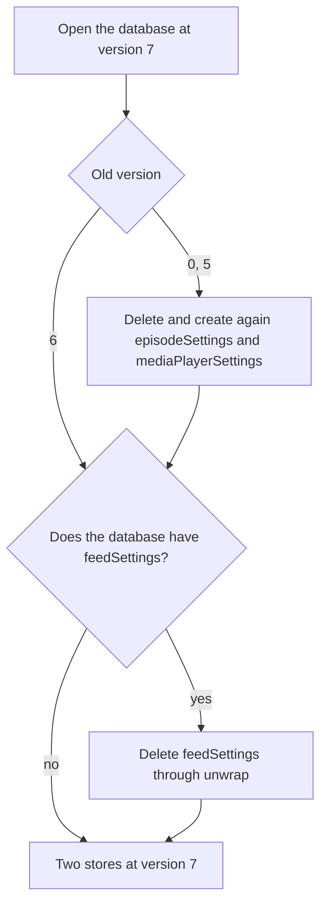
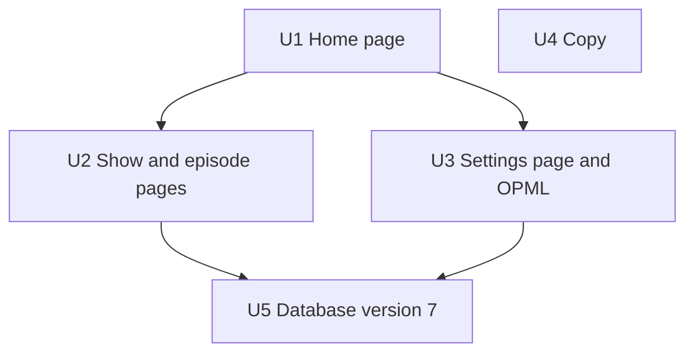

# Remove Subscriptions from the Site - Plan

## Goal Capsule

- **Objective:** A visitor to `pod.monster` finds no subscription feature, and no browser keeps a list of subscriptions from the site. Thus, the site never shows a second list of subscriptions beside the Pod Monster app.
- **Means:** Delete the subscription code, the Settings page, and the OPML import and export (KTD1). A version 7 upgrade of the browser database deletes the saved subscriptions (KTD2).
- **Product authority:** This Product Contract. The user owns every product decision. An R wins on product behavior, and a KTD wins on mechanism.
- **Execution profile:** Standard. Five units on the branch `remove-subscriptions`. The user runs the plan with `lfg`: `ce-work` implements, and the pipeline reviews the change and opens the pull request. The run asks no question. The user approves the copy of "Copy changes" in the pull request, before the merge.
- **Stop conditions:** Stop and report when one of these is true:
  - The upgrade to version 7 deletes or hides a saved play position or the player state (AE1).
  - The upgrade from version 0, 5, or 6 throws.
  - A caller of a removed API route appears outside this repo.
  - A reference image that "Definition of Done" does not name changes, and the cause is not render noise.
- **Open blockers:** None.

---

## Product Contract

### Summary

The site removes every subscription feature. The home page keeps only search. The "Subscribe" button, the "Subscriptions" list, the "new episode" dot, and the Settings page with OPML import and export go away. A database upgrade deletes the subscriptions that each browser saved. Saved play positions and the player state stay.

### Problem Frame

The native app is now the main Pod Monster app, and the site will mainly serve share links from it. The site keeps its own subscriptions in the browser, apart from the subscriptions in the app. A visitor who uses both thus sees two lists that do not agree. The user decided to remove subscriptions from the site for now.

### Key Decisions

- **Remove the Settings page with OPML import and export.** (session-settled: user-approved, chosen over a short period with the OPML export only: the page holds nothing else.) Governs R4.
- **Delete the saved subscriptions from each browser.** (session-settled: user-approved, chosen over records that stay in place, unread: the share-link change emptied every library on 2026-10-20, so the data is at most days old.) Governs R7.
- **Give past subscribers no notice.** The confirmed scope keeps only search on the home page, and the repo has no link to the app that a notice can point to. Governs R2.
- **`/settings` shows the not-found page.** Nothing replaces the page, and a redirect to the home page hides that the feature is gone. Governs R5.
- **Remove the "Known Issues" section of the About page.** Its one item tells the visitor how to keep subscriptions safe with an OPML backup. Without subscriptions, a share-link visitor does not need the item. Governs R10.

### Requirements

**Subscription features**

- R1. No page offers a "Subscribe" or "Unsubscribe" button: not search results, show pages, or episode pages.
- R2. The home page shows search only. It has no "Subscriptions" list and asks the server for no new episodes.
- R3. Episode lists show no "new episode" dot.

**Settings and OPML**

- R4. The site has no Settings page, no OPML import, and no OPML export. No page or sitemap links to `/settings`.
- R5. A request for `/settings` shows the not-found page, and the header on that page shows no "/ Settings" crumb.
- R6. The API routes that only subscriptions used, `/api/podcasts/episodes` and `/api/settings/opml/import`, do not exist.

**Saved data**

- R7. When a browser next opens the site, the site deletes the subscriptions that the browser saved.
- R8. Saved play positions and the player state stay through the change of R7.
- R9. While an old tab blocks the change of R7, the another-tab notice tells the visitor what waits, and does not name a library.

**Copy**

- R10. No end-user copy on the site tells the visitor to subscribe, or names subscriptions or an OPML backup.

### Acceptance Examples

- AE1. **Covers R7, R8.** Given a browser database at version 6 with a subscription, a saved play position, and a player state, when the visitor opens the site, then the subscription is gone, and the position and the player state are there.
- AE2. **Covers R7, R9.** Given a tab with version 5 code is open, when the visitor opens the site in a new tab, then the another-tab notice shows. When the visitor closes the old tab, the page finishes its load with no subscriptions.
- AE3. **Covers R7.** Given a tab with version 6 code is open, when the visitor opens the site in a new tab, then the upgrade finishes with no notice, and the old tab saves nothing more.
- AE4. **Covers R7.** Given a browser that never opened the site, when the visitor opens it, then the database opens with no error.
- AE5. **Covers R5.** Given a bookmark to `/settings`, when the visitor opens it, then the not-found page shows, and its header shows no "/ Settings" crumb.

### Scope Boundaries

- A notice or a link for past subscribers is out of scope (see Key Decisions).
- A redirect for `/settings`, and a stub for the removed API routes, are out of scope (R5, KTD4).
- Other About page claims stay as they are, for example "manage and consume podcasts" in "Mission".
- The not-found page copy ("Hopefully I didn't break something...") stays as it is.

#### Deferred to Follow-Up Work

- `PodcastFeed.format` (`types/PodcastFeed.ts`) has no reader in the app after the removal. The server mappers set it, and their tests assert it.
- `utils/createApiErrorResponse.ts` keeps only the `ApiErrorResponse` type after U3, so its name no longer fits.
- After U1 and U3, no server route sends an error `message`. The `message` branch of `getErrorMessage` in `utils/request.ts` has no live producer.
- `utils/request.test.ts` and `utils/redactFeedPaths.test.ts` use the removed route paths as sample strings. Both tests still pass.
- The search results on the home page skip each dead feed, and the "Include dead feeds" checkbox does not change that (`app/HomePage.tsx`). This bug is older than this change.
- `icons/download2.svg` and `icons/upload2.svg` lose their last importer. The IcoMoon set in `icons/` keeps unused icons by convention, and lint does not check SVG files.

### Dependencies / Assumptions

- No local checkout of the native app (`pod-monster-native` and its worktrees) calls `/api/podcasts/episodes` or `/api/settings/opml/import`. A search on 2026-10-24 found no call.
- Production deploys on Vercel, where an instant rollback to an older build is possible. See "Operational Notes" for the rule after the version 7 deploy.

---

## Planning Contract

### Key Technical Decisions

- KTD1. **Delete the code, with no feature flag.** (session-settled: user-approved, chosen over a feature flag: git history keeps the code for a later return.) The lint rule `import/no-unused-modules` with `unusedExports: true` fails on each module or export that loses its last importer (`eslint.config.mjs`). Thus, each module that only subscription code uses goes too:
  - `components/atoms/Dot/`, `components/molecules/FileField/`, and `components/molecules/FeedArtwork.tsx`.
  - The `export` of `ArtworkComponentProps` in `components/atoms/Artwork.tsx`. The type stays, for use in that file only.
  - The `createApiErrorResponse` function. The `ApiErrorResponse` type stays, because `utils/request.ts` uses it.
  - The `opml-to-json` dependency and `declarations/OpmlToJson.d.ts`.
  - The `--color-accent-*` tokens in `styles/globals.css`, which only `Dot` uses.
  - The `export` of `FeedReference` in `utils/paths.ts`, in U5. The type stays, because `EpisodeReference` and `getPodcastPath` in that file use it.
- KTD2. **A version 7 upgrade deletes the `feedSettings` store.** (session-settled: user-approved, chosen over records that stay in place, unread: no saved subscription stays in a browser with no page to show it or clear it.) Governs R7, R8.
  - `SETTINGS_VERSION` becomes 7. The schema and `STORE_NAMES` drop `feedSettings`.
  - The `oldVersion < 6` step stays. It now resets only `episodeSettings` and `mediaPlayerSettings`, so a version 5 database still holds `feedSettings` after it.
  - A new `oldVersion < 7` step deletes `feedSettings` when the database has it. The step reaches the store through `unwrap` from `idb`. The typed `IDBPDatabase` accepts only schema store names, and the `idb` README suggests a cast here, but production code must not use `as`.
  - The check for the store is necessary. A new database (version 0) has no `feedSettings`. An error in the upgrade aborts it, so the same error then occurs on each load.
  - Each call in the upgrade stays synchronous, so the upgrade transaction does not commit early.
  - A clear of the records at version 6 has no rollback risk, but it keeps an unused store in the schema of each browser. The decision keeps the upgrade.
  - Conflict call-out: after the version 7 build serves a visitor, a rollback to a version 6 build fails each database open of that visitor with `VersionError`. Saved positions then stay hidden, and the site saves no new position, until a deploy at version 7 or higher. The decision holds, with the "roll forward only" rule in "Operational Notes".
- KTD3. **The settings context keeps only episode and player members.** `feedSettings`, `getFeedSettingsItem`, `setFeedSettingsItem`, `setAllFeedSettings`, `FeedSettingsItem`, and the `FeedSettings` export go. `getFeedKey` stays, because `getEpisodeKey` uses it. Thus, the episode keys do not change, and AE1 holds with no change to the saved positions.
- KTD4. **The removed API routes return 404, with no stub.** A stub with an error message does not help an old client. `request` throws a plain `Error`, and the old Settings page shows an error only when the value has an `error` field.
- KTD5. **The server pages send only the fields that the client reads.** The show page uses `Artwork` directly in place of `FeedArtwork`. The episode page passes only `funding` to `EpisodePage`, because no other field of `feed` has a reader after the removal. This follows the rule in the comment above `toHeaderFeed` in `app/feeds/[feedUrlBase64]/page.tsx`: the RSC payload holds only the fields that the client component reads.
- KTD6. **The database tests split the old shape from the new shape.** The test constant `STORE_NAMES` in `contexts/SettingsContext/SettingsContext.test.tsx` now has two roles: the stores of an old database, and the stores after the upgrade. It must become two constants. The tests that open "a newer version" at 7 move to 8. The tests that prove a write, a failed write, or the feed-key rules use the episode API in place of the feed API.
- KTD7. **No new telemetry on the upgrade.** The current `settings_db_open_failed` event already reports an open that fails, with `reason` and `errorName` only. A count of the deleted records needs an async request inside the upgrade, and the upgrade must stay synchronous (KTD2).

No decision qualified for a bake-off. The one mechanism choice, `unwrap` against a cast, is small and easy to reverse.

### High-Level Technical Design

The upgrade runs each step in order for the version of the database that the browser has now.

| Old version      | `< 6` step                                                            | `< 7` step                            | Result                                      |
| ---------------- | --------------------------------------------------------------------- | ------------------------------------- | ------------------------------------------- |
| 0, a new browser | Creates the two stores                                                | No `feedSettings`, so it does nothing | Two empty stores (AE4)                      |
| 5                | Deletes and creates again the two stores, and removes `pod2.settings` | Deletes `feedSettings`                | Two empty stores, as at version 6 today     |
| 6                | Does not run                                                          | Deletes `feedSettings`                | Saved positions and player state stay (AE1) |
| 7                | Does not run                                                          | Does not run                          | No change                                   |

### Copy changes

This copy is for a non-developer, so it follows the plain, warm English rules. The implementation applies it as written. The user approves it in the pull request, before the merge.

| Place                                      | Now                                                                                                                                                   | After                                                                                                                                 |
| ------------------------------------------ | ----------------------------------------------------------------------------------------------------------------------------------------------------- | ------------------------------------------------------------------------------------------------------------------------------------- |
| Home page description, `app/page.tsx`      | "Search for and subscribe to podcasts"                                                                                                                | "Search for podcasts"                                                                                                                 |
| About, "How it works"                      | A second paragraph about subscriptions and the "Subscriptions" list                                                                                   | The paragraph goes. The first paragraph, about the Podcast Index, stays.                                                              |
| About, "Principles"                        | "No account is required to subscribe to or listen to podcasts (though certain limits may need to be imposed eventually due to browser restrictions)." | "No account is required to listen to podcasts (though certain limits may need to be imposed eventually due to browser restrictions)." |
| About, "Known Issues"                      | One item about storage and an OPML backup                                                                                                             | The whole section goes (see Key Decisions).                                                                                           |
| Another-tab notice, `AnotherTabNotice.tsx` | "Pod Monster is open in another tab. Close that tab, and this page will finish loading your library."                                                 | "Pod Monster is open in another tab or window. Close it, and you'll be able to play episodes."                                        |
| Footer                                     | Home, About, Settings, GitHub                                                                                                                         | Home, About, GitHub                                                                                                                   |

The notice names a window too, because an installed web app window on the desktop shares the database with the browser. The notice does not promise saved positions. Only a tab with version 5 code blocks the upgrade, and the `< 6` step then resets the saved positions of that browser.

### Sequencing

U1, U2, and U3 remove each caller of the feed API. U5 then changes the database. U3 comes after U1, because U1 deletes the other caller of `createApiErrorResponse`. U4 has no dependency. Each unit leaves lint, the type check, and the tests green.

---

## Implementation Units

### U1. Keep only search on the home page

- **Goal:** The home page shows search only, and the new-episode refresh goes.
- **Requirements:** R1, R2, R6, R10. KTD1.
- **Dependencies:** None.
- **Files:**
  - Modify `app/HomePage.tsx`, `app/HomePage.test.tsx`, and `app/page.tsx`.
  - Delete `components/molecules/SubscriptionItem/`, with its `__screenshots__/` folder.
  - Delete `rest/fetchPodcastEpisodes.ts` and `app/api/podcasts/episodes/route.ts`.
  - Modify `docs/solutions/best-practices/css-text-box-trim-pitfalls-in-chromium.md`.
- **Approach:**
  1. Remove the "Subscriptions" list, the refresh query, the `SubscribeButton` in each search row, and the import of `useSettingsContext` from `HomePage`.
  2. Change the page description per "Copy changes".
  3. Delete `SubscriptionItem`, the REST client, and the route.
  4. Change the guidance in the text-box-trim doc so that it names one clamp call site, `EpisodePlayButton.tsx`.
- **Patterns to follow:** The search row keeps its `LinkStack`. The page has no screenshot, so the layout of the row can stay as it is.
- **Test scenarios:**
  - A search result still links to the show path of its feed URL (the current test, with the "Subscribe" part removed).
  - A search result shows no "Subscribe" button.
  - Delete the tests that only cover the list, the refresh, the dot, and the `toSorted` fix of the refresh, and their fixtures.
- **Verification:** Lint passes with no orphan export. `HomePage.test.tsx` passes. The `SubscriptionItem` screenshots folder is gone.

### U2. Remove the "Subscribe" button and the dot from show and episode pages

- **Goal:** No show page, episode page, or episode list shows a subscription control or the "new episode" dot.
- **Requirements:** R1, R3. KTD1, KTD5.
- **Dependencies:** U1, which removes the home page caller of `SubscribeButton`.
- **Files:**
  - Delete `components/atoms/SubscribeButton/`, `components/molecules/EpisodeUnlistenedDot/`, and `components/atoms/Dot/`, each with its `__screenshots__/` folder.
  - Delete `components/molecules/FeedArtwork.tsx`, `components/molecules/FeedArtwork.test.tsx`, and `components/molecules/__screenshots__/FeedArtwork.test.tsx/`.
  - Modify `components/molecules/EpisodeList.tsx`, `components/atoms/Artwork.tsx`, and `styles/globals.css`.
  - Modify `app/feeds/[feedUrlBase64]/page.tsx`, `app/feeds/[feedUrlBase64]/episodes/[guidBase64]/page.tsx`, `app/feeds/[feedUrlBase64]/episodes/[guidBase64]/EpisodePage.tsx`, and `app/feeds/[feedUrlBase64]/episodes/[guidBase64]/EpisodePage.test.tsx`.
  - Modify `docs/solutions/best-practices/tailwind-classname-conflicts-resolve-by-stylesheet-order.md`.
- **Approach:**
  1. Remove the dot from `EpisodeList`. Keep `datePublished` in its `Pick`, because `EpisodeProgress` reads it.
  2. On the show page, replace `FeedArtwork` with `Artwork`, and remove `SubscribeButton` and `toSubscribeButtonFeed` (KTD5).
  3. On the episode page, remove `SubscribeButton`, and narrow the `feed` prop and `toEpisodePageFeed` to `funding` (KTD5).
  4. Remove the `export` of `ArtworkComponentProps`, and remove the `--color-accent-*` tokens (KTD1).
  5. The longhand-override guidance in the Tailwind doc loses its only example. Name another live example if one exists. Else, keep the rule with no example.
- **Patterns to follow:** `toHeaderFeed` in `app/feeds/[feedUrlBase64]/page.tsx` for a narrow client payload.
- **Test scenarios:**
  - `EpisodePage` shows no "Subscribe" button for a full feed fixture.
  - `EpisodePage` still shows the funding links of the feed after the prop narrows.
  - The `episodeList-default` and `episodeList-default-dark` images pass with no update. A diff means that the removal changed the row layout.
- **Verification:** Lint and the type check pass. The four deleted screenshots folders are gone. The `episodeList` images do not change.

### U3. Remove the Settings page and OPML

- **Goal:** The site has no Settings page, no OPML import or export, and no link to `/settings`.
- **Requirements:** R4, R5, R6. Key Decisions: the Settings page and `/settings`. KTD1, KTD4.
- **Dependencies:** U1, which deletes `app/api/podcasts/episodes/route.ts`, the other caller of `createApiErrorResponse`.
- **Files:**
  - Delete `app/settings/`, `app/api/settings/`, `hooks/useOpmlFileUrl.ts`, `hooks/useOpmlFileUrl.test.tsx`, `rest/fetchOpmlImport.ts`, and `declarations/OpmlToJson.d.ts`.
  - Delete `components/molecules/FileField/`, with its `__screenshots__/` folder.
  - Modify `utils/createApiErrorResponse.ts`, `package.json`, and `package-lock.json`.
  - Modify `contexts/SettingsContext/index.ts` and `contexts/SettingsContext/SettingsContext.tsx`.
  - Modify `components/molecules/Footer/Footer.tsx` and `components/molecules/Footer/Footer.test.tsx`.
  - Modify `components/molecules/Header/Header.tsx` and `components/molecules/Header/Header.test.tsx`.
  - Modify `app/sitemap.ts` and `CONTRIBUTING.md`.
- **Approach:**
  1. Delete the page, the import route, the hook, the REST client, the declaration, and `FileField`.
  2. Remove the `createApiErrorResponse` function, and keep the `ApiErrorResponse` type (KTD1).
  3. Remove `type FeedSettings` from the re-export in `contexts/SettingsContext/index.ts`, and remove the `export` of `FeedSettings` in `SettingsContext.tsx`. Step 1 deletes its last three importers, and lint fails on an export with no importer. U5 then deletes the type (KTD3).
  4. Remove `opml-to-json` with `npm uninstall opml-to-json`, so that the lock file drops its four dependencies too.
  5. Remove the "Settings" link from the footer, `settings` from the sitemap, and `'/settings'` from `isStaticPage` in the header. The header change makes AE5 true.
  6. Remove the `settings` scope from the scope list in `CONTRIBUTING.md`.
- **Test scenarios:**
  - The footer shows three links: Home, About, and GitHub.
  - The header tests that use `/settings` as the static page use `/about`, and the hover test finds the "About" link.
  - Covers AE5. The header on a path that is not a static page shows no crumb for the path.
- **Verification:** The `footer-default`, `footer-default-dark`, and `header-static-page` images change as intended. The `FileField` screenshots folder is gone. `package.json` has no `opml-to-json`.

### U4. Change the copy that names subscriptions or the library

- **Goal:** No end-user copy names subscriptions, an OPML backup, or a library.
- **Requirements:** R9, R10. Key Decisions: the "Known Issues" section.
- **Dependencies:** None.
- **Files:**
  - Modify `app/about/page.tsx`.
  - Modify `components/molecules/AnotherTabNotice/AnotherTabNotice.tsx` and `components/molecules/AnotherTabNotice/AnotherTabNotice.test.tsx`.
- **Approach:**
  1. Apply each About page row of "Copy changes".
  2. Remove `'Known Issues'` from the `Heading` union. Remove `HeadingAnchorLink` and the `Link` import, because they lose their last use, and lint fails on an unused variable.
  3. Apply the another-tab notice row of "Copy changes".
- **Test scenarios:**
  - The another-tab notice shows the new copy while `isBlockedByAnotherTab` is true.
  - The About page has no test. Test expectation: none for the About page, because it is static copy, and lint catches an unused import.
- **Verification:** The `anotherTabNotice-default` and `anotherTabNotice-default-dark` images change as intended.

### U5. Delete the saved subscriptions with a version 7 database upgrade

- **Goal:** Each browser deletes its saved subscriptions at the next open, and keeps its saved positions and player state.
- **Requirements:** R7, R8. KTD2, KTD3, KTD6, KTD7.
- **Dependencies:** U1, U2, U3, because they remove each caller of the feed API.
- **Files:**
  - Modify `contexts/SettingsContext/SettingsContext.tsx`, `contexts/SettingsContext/index.ts`, and `contexts/SettingsContext/SettingsContext.test.tsx`.
  - Modify `utils/paths.ts`.
  - Modify the comments that name the library: `utils/normalizeFeedUrl.ts`, `app/feeds/[feedUrlBase64]/page.tsx`, and `app/feeds/[feedUrlBase64]/episodes/[guidBase64]/page.tsx`.
  - Test with no change: `contexts/MediaContext.test.tsx`.
- **Approach:**
  1. Apply the upgrade of KTD2, and remove the feed members of KTD3.
  2. Remove the feed reads from `readSettings`.
  3. Remove the `export` of `FeedReference` in `utils/paths.ts`, because step 1 removes its last importer (KTD1).
  4. Change the comment above `upgradeDatabase` so that it describes the version 7 step. Change each comment that names the library, so that it names the saved episode data.
- **Execution note:** Write the version 6 test of AE1 first. It is the main proof of the scope, and no current test proves that an upgrade keeps data.
- **Patterns to follow:** The current helpers in `SettingsContext.test.tsx`: `deleteDatabase`, `createVersion5Database`, `readDatabase`, and `renderHydratedSettingsContext`. A new version 6 helper must build each episode key the way `getEpisodeKey` does.
- **Test scenarios:**
  - Covers AE4. A new database opens at version 7 with the two stores, and Sentry receives no event.
  - Covers AE1. A version 6 database with one record in each of the three stores opens at version 7 with two stores. `getEpisodeSettingsItem` returns the saved `currentTime`, `hydratedMediaPlayerSettings` equals the saved state, and Sentry receives no event.
  - A version 5 database with the three stores opens at version 7 with two empty stores, and `pod2.settings` is gone. A write with `setEpisodeSettingsItem` then works.
  - A version 5 database without one of its stores opens at version 7 with the two stores.
  - Covers AE2. A version 5 connection that does not close sets `isBlockedByAnotherTab` and sends `settings_db_open_blocked`. After the close, the database is at version 7 with two stores, and a write works.
  - Covers AE3. A version 6 connection that closes on `versionchange` lets the upgrade finish, sends no `settings_db_open_blocked`, and its episode record survives.
  - A provider at version 7 closes when another connection opens version 8, and a later `setEpisodeSettingsItem` writes nothing.
  - A database at version 8 makes the open fail with `{ errorName: 'VersionError', reason: 'open_failed' }`, and the episode state is empty. This test also models the rollback of KTD2.
  - A timeout ends hydration with empty episode and player state.
  - A value that cannot be cloned makes `setEpisodeSettingsItem` send `settings_db_write_failed` with `storeName: 'episodeSettings'`.
  - The feed-key rules (host case, fragment, query case) hold through `setEpisodeSettingsItem` and `getEpisodeSettingsItem`.
  - `MediaContext.test.tsx` restores the player at version 6 with no change. Its fixture keeps `feedSettings`, because that is the real shape of a version 6 database.
- **Verification:** All `SettingsContext` and `MediaContext` tests pass. The context exports no feed member.

---

## Risks

| Risk                                                                                                                   | Mitigation                                                                                                  |
| ---------------------------------------------------------------------------------------------------------------------- | ----------------------------------------------------------------------------------------------------------- |
| A rollback to a version 6 build after the deploy hides saved positions for each upgraded visitor (KTD2).               | Roll forward only (see "Operational Notes").                                                                |
| An error in the `< 7` step aborts the upgrade on each load.                                                            | The store check of KTD2, and the tests from version 0, 5, and 6 in U5.                                      |
| A version 6 tab that stays open after the upgrade saves no more positions until a reload.                              | Accepted. The version 6 code closes its connection on purpose, and the new code cannot change the old code. |
| Past subscribers lose their list with no notice and no export.                                                         | Accepted (see Key Decisions). The library of each browser has data from 2026-10-20 or later only.           |
| A deleted test file leaves its `__screenshots__/` folder, because `npx vitest run -u` does not delete an orphan image. | Delete each folder by hand. "Definition of Done" lists them.                                                |
| An old `.next` folder holds types for `app/settings`, so `npm run typecheck` fails in that checkout.                   | Delete `.next`. `npm run dev` and `npm run build` already delete it.                                        |

---

## Operational Notes

- **Roll forward only.** After the version 7 build serves traffic, do not roll back to a version 6 build. A fix ships as a new deploy at version 7 or higher. If subscriptions come back later, a version 8 step can create the store again.
- **Sentry after the deploy.** These events are expected and rare:
  - `settings_db_open_blocked`, from a tab with version 5 code.
  - `settings_db_open_failed` with `VersionError`, from an old page that opens after the upgrade.
- **Canary events.** `settings_db_open_failed` with `AbortError` or `NotFoundError`, or an uncaught error from `deleteObjectStore`, means that the `< 7` step failed. Fix it forward.
- **Events that stop.** `opml_import_parse_failed`, and `settings_db_write_failed` or `settings_invalid_feed_url` with `storeName: 'feedSettings'`. A Sentry alert or saved search on these events goes stale.
- **Local development.** After a run of this branch, the local database is at version 7. A later run of `main` on the same port hydrates empty with `VersionError`. To go back, delete the `pod.monster` database in the browser developer tools.

---

## Verification Contract

| Gate                  | Command                              | When                                                                                                                             |
| --------------------- | ------------------------------------ | -------------------------------------------------------------------------------------------------------------------------------- |
| Format and lint fixes | `npm run format && npm run lint:fix` | After each unit                                                                                                                  |
| Lint, zero warnings   | `npm run lint`                       | After each unit. It catches each orphan export (KTD1).                                                                           |
| Type check            | `npm run typecheck`                  | After each unit. CI does not run it.                                                                                             |
| Tests                 | `npx vitest run`                     | After each unit                                                                                                                  |
| Reference images      | `npx vitest run -u`                  | Only for the intended image changes in U3 and U4. Look at each changed image, and restore each image that changed only by noise. |

All checks together: `npm run format && npm run lint:fix && npm run lint && npm run typecheck && npx vitest run`.

Manual check of AE3, for the reviewer after the pull request opens. It is not a gate of the run, because it needs builds of two commits on one origin. The U5 tests cover AE3.

1. In the browser developer tools for `http://localhost:3000`, delete the `pod.monster` database. An earlier run of this branch leaves it at version 7, and then step 3 has no upgrade to test.
2. Run the `main` build on port 3000 with `npm run build && npm run start`, and open a tab. Expect the developer tools to show the `pod.monster` database at version 6.
3. Stop it, run the build of this branch on the same port with `npm run build && npm run start`, and open a second tab.
4. Expect the second tab to load with no notice, and the developer tools to show the database at version 7 with two stores. Expect `/settings` in the second tab to show the not-found page.

---

## Definition of Done

- R1 to R10 are true, and AE1 to AE5 pass.
- All gates of the Verification Contract pass.
- A case-insensitive search for "subscri" in the source files (not the test files) of `app/`, `components/`, `contexts/`, `hooks/`, `rest/`, and `utils/` finds only two files:
  - `components/molecules/StartTimePrompt/StartTimePrompt.tsx`, for `subscribeToNothing`.
  - `utils/isPrivateFeedUrl.ts`, for the hosts and paths of private feeds.
- These `__screenshots__/` folders are gone: `SubscribeButton`, `SubscriptionItem`, `EpisodeUnlistenedDot`, `Dot`, `FileField`, and `FeedArtwork`.
- Only these reference images change: `header-static-page`, `footer-default`, `footer-default-dark`, `anotherTabNotice-default`, and `anotherTabNotice-default-dark`. The pull request body names each one and the cause of its change.
- `package.json` and `package-lock.json` have no `opml-to-json`.
- The pull request body shows the "Copy changes" table, so that the user can approve the copy before the merge.
- The pull request body carries the "Roll forward only" rule of "Operational Notes", because a merge to `main` deploys to production.
- The diff holds no dead code or experiment from an abandoned approach.

| Unit | Done when                                                                                                                      |
| ---- | ------------------------------------------------------------------------------------------------------------------------------ |
| U1   | The home page has no subscription code, and `/api/podcasts/episodes` is gone.                                                  |
| U2   | No show page, episode page, or episode list renders a subscription control or the dot. The `episodeList` images do not change. |
| U3   | `/settings` and `/api/settings/opml/import` are gone, and nothing links to `/settings`.                                        |
| U4   | Each row of "Copy changes" is applied.                                                                                         |
| U5   | The database is at version 7 with two stores, and AE1 to AE4 pass.                                                             |
